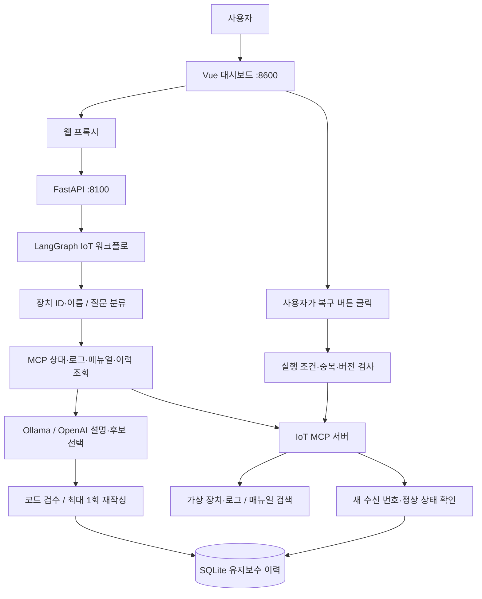
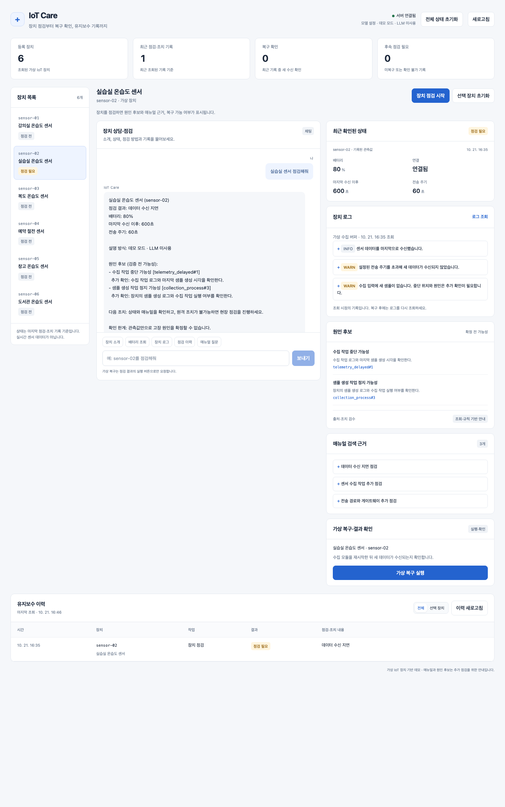
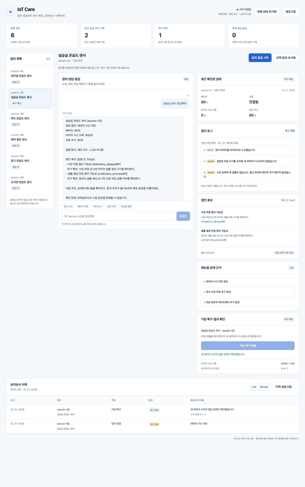

# IoT Care Agent

**IoT 장치 장애 진단 및 원격 복구 지원 AI 에이전트**

장치 상태·로그·매뉴얼·점검 이력을 조회해 원인 후보와 점검 순서를 안내하고, 사용자가 실행한 가상 복구의 결과를 확인·기록하는 서비스입니다.

[GitHub 저장소](https://github.com/nahKKhan/skala-iot-care-agent) · [개발 가이드](IMPLEMENTATION_GUIDE.md) · [문서 목차](doc/README.md)

## 1. 주제 선정 배경과 해결할 문제

아두이노와 BLE 모듈로 여러 장치의 통신을 시도하면서, 연결 여부만으로 통신이 안정적인지 판단하기 어렵고 조치 이후 데이터가 다시 들어오는지 확인해야 했던 경험에서 출발했습니다.

가상 강의실·실습실 센서를 관리하는 담당자를 대상으로, 이상 알림 이후 필요한 다음 작업을 한 흐름으로 연결했습니다.

- **무슨 상황인지 확인**: 연결 끊김, 낮은 배터리, 수신 지연, 예정된 절전을 구분합니다.
- **무엇부터 점검할지 결정**: 장치 로그와 검색된 매뉴얼을 바탕으로 원인 후보·추가 확인 사항을 안내합니다.
- **조치가 효과가 있었는지 확인**: 명령 접수 이후 새 데이터 수신을 검증하고 유지보수 이력에 남깁니다.

핵심 목표는 원인 파악과 조치에 드는 시간을 줄이는 것입니다. 현재는 가상 장치로 기능을 검증했으며, 실제 현장의 작업 시간 단축 효과는 측정하지 않았습니다. BLE 멀티 통신 자체를 구현한 프로젝트는 아닙니다.

## 2. 주요 구현 기능

| 기능 | 현재 동작 |
|---|---|
| 장치 검색·질문 분류 | ID와 등록된 이름으로 장치를 찾습니다. 이름이 겹치면 후보를 안내하고, 점검 대상은 하나를 지정합니다. |
| MCP 상태·로그·이력 조회 | 현재 관측값, 가상 수집 버퍼의 이벤트, SQLite 유지보수 이력을 조회합니다. |
| 상태 진단 | 배터리·연결·수신 주기와 절전 설정을 코드로 판정합니다. |
| RAG 매뉴얼 검색 | 자체 작성 매뉴얼 10종·30문단을 BM25와 한국어 단어·문자 2-gram으로 검색합니다. |
| 원인 후보 설명·검수 | LLM이 검색된 후보를 선택하고 설명합니다. JSON Schema·Pydantic·출처/수치/조치 정책 검수를 적용합니다. 미달 시 최대 한 번 재작성하고 규칙 안내로 대체합니다. |
| 사용자 실행형 가상 복구 | 버튼으로 수집 모듈 재시작을 요청합니다. 실행 조건·중복 요청·진단 후 상태 변경을 검사합니다. |
| 복구 여부 확인 | 명령 전후 수신 번호 증가와 정상 상태를 확인해 복구 확인·미복구·확인 불가를 구분합니다. |
| 유지보수 기록 | 진단 근거·조치 전후 관측값·결과·생성/갱신 시각을 저장합니다. 미복구 시 현장 점검 필요로 기록합니다. |
| 화면·초기화 | 채팅, 장치 상태, 로그, 원인 후보, 매뉴얼, 복구 결과, 이력을 표시합니다. 선택/전체 가상 상태 초기화를 지원합니다. |

현장 점검 기능은 필요 여부·안내 기록까지 구현했습니다. 현장 작업자의 세부 체크리스트 입력·완료 관리는 아직 구현하지 않았습니다.

## 3. 개발 환경과 기술 스택

| 구분 | 구성 |
|---|---|
| 검증 환경 | macOS, Python 3.14, Node.js(화면 로직 테스트용) |
| 화면 | Vue 3 CDN, HTML/CSS, SSE 진행 이벤트 |
| API | FastAPI, Uvicorn, HTTPX, Pydantic |
| 에이전트 흐름 | LangGraph 단일 워크플로 |
| 도구 연결 | FastMCP / MCP stdio, IoT 도구 서버 1개 |
| 검색·데이터 | BM25 문단 검색, JSON 가상 데이터, SQLite |
| 설명 모델 | Ollama 또는 OpenAI 어댑터, 모델 미사용 규칙 모드 |
| 관찰·검증 | 선택적 LangSmith 추적, Python unittest, Node.js test runner |

질문 분류·상태 판정·복구 허용·결과 판정은 코드가 담당합니다. LLM은 제공된 근거 안에서 원인 후보를 고르고 설명합니다.

## 4. 시스템 아키텍처



주요 진단 흐름: **대상 확인 → 관측 상태 판정 → 로그·매뉴얼·이력 조회 → 모델 설명 → 검수 → 기록**.
복구는 사용자 버튼/API 요청으로 별도 실행합니다. 채팅에서 재시작을 요구한 것만으로 명령을 실행하지 않습니다.

## 5. 베이스 코드와 Before / After

| 항목 | 제공 베이스 | 현재 IoT 서비스 |
|---|---|---|
| 문제 영역 | 웹 서버 운영 인시던트·CPU/메모리 예제 | IoT 배터리·연결·수신 지연·절전 |
| 그래프 | 라우팅·계획·조사·보고서 작성 실습 | IoT 조회·RAG·설명·검수·기록, 별도 복구 검증 |
| MCP | 모니터링 Tool·예제 Resource/Prompt·보조 서버 | 상태·로그·검색·이력·복구·초기화 Tool |
| 데이터 | 서버 지표와 예제 runbook | 가상 장치 6개, 이벤트 로그, 매뉴얼 10종 |
| 이력 | SQLite 대화 저장 | 대화 저장에 유지보수·복구 요청 원장 추가 |
| 화면 | 대화 중심 Vue 화면 | 장치 목록·근거·복구 결과·이력 대시보드 |

**재사용한 구조:** FastAPI 수명 관리, MCP stdio, Vue/SSE, 모델 어댑터, SQLite 대화 저장.
**새로 구현한 부분:** 관측·절전 규칙, 가상 시뮬레이터와 로그, RAG, 후보·출처 검수, 복구 API·중복 방지·버전 검사, 유지보수 이력, 장치 이름 검색, 전체 초기화, 평가기와 회귀 테스트.

미사용 그래프·v1 분기·fast 모델·예제 모니터링·보조 MCP 서버·옛 매뉴얼을 정리했습니다. 기존 실행 스크립트의 DB 삭제·포트 강제 종료도 제거했습니다. [정리 내역](doc/code_cleanup.md)

## 6. 설치와 실행

프로젝트 루트에서 실행합니다. 기존 `.venv`와 `.env`가 있으면 그대로 사용합니다.

### 환경 준비

```bash
bash sh/setup_venv.sh
```

`.env.example`을 참고해 `.env`를 준비합니다. API 키는 Git에 올리지 않습니다.

```dotenv
OPENAI_API_KEY=본인의_API_키
OPENAI_QUALITY_MODEL=gpt-4o
OLLAMA_QUALITY_MODEL=qwen3.5:2b
LANGCHAIN_TRACING_V2=false
LANGSMITH_TRACING=false
```

### 백엔드: 아래 모드 중 하나

기존 8100 백엔드는 실행 중인 터미널에서 `Ctrl+C`로 종료한 뒤 전환합니다.

```bash
# OpenAI: 유효한 API 키 필요. 호출 시 API 사용 요금이 발생할 수 있습니다.
bash sh/run_iot_agent.sh openai
```

```bash
# Ollama: 별도 터미널에서 서버를 켜둡니다.
ollama serve
# 모델이 없을 때만 다른 터미널에서 실행합니다.
ollama pull qwen3.5:2b
# 그다음 새 터미널에서 백엔드를 실행합니다.
bash sh/run_iot_agent.sh ollama
```

```bash
# 실제 모델 호출 없이 기능을 시연합니다.
bash sh/run_iot_agent.sh fake
```

### 웹 화면: 다른 터미널

```bash
bash sh/run_frontend.sh
# 또는 .venv/bin/python web_demo_server.py
```

브라우저에서 **http://localhost:8600**에 접속합니다. 백엔드 코드를 바꾼 경우 재시작하고, 화면 코드만 바꿨다면 브라우저를 새로고침합니다.

```bash
curl http://localhost:8100/health
```

`pipeline: iot`, `llm_backend`, `quality_llm`은 실행 설정 확인용입니다. 실제 모델 응답 성공 시 답변의 `설명 모델: openai:...` 또는 `ollama:...`를 확인합니다. 모델 실패 시 대체 안내 문구가 표시됩니다.

LangSmith 추적은 기본 비활성화입니다. 필요한 키·프로젝트를 설정하면 활성화할 수 있으며, 추적 화면 캡처를 이 프로젝트의 실측 결과로 추가하지 않았습니다. [모델 연결 상세](doc/llm_connection.md)

## 7. 질문 예시와 실행 화면

| 질문 | 처리 |
|---|---|
| `복도를 관리하는 센서가 뭐가 있더라?` | 등록 이름에서 sensor-03 검색 |
| `실습실 센서 점검해줘` | sensor-02 상태·로그·RAG 진단 |
| `sensor-02 배터리 얼마나 남았어?` | 잔량 조회 |
| `복도 센서 로그 보여줘` | 최근 가상 장치 이벤트 조회 |
| `sensor-02 점검 기록 보여줘` | 저장된 유지보수 이력 조회 |
| `정상 절전과 수신 지연은 어떻게 달라?` | 일반 매뉴얼 검색 |

이름 검색은 등록 문자열을 기준으로 합니다. 관리 구역이나 등록되지 않은 동의어를 추측하지 않습니다. 단순 소개·상태·로그·이력·매뉴얼 조회에는 LLM을 호출하지 않습니다.

### 진단·검색 근거



### 복구 결과·유지보수 이력



위 이미지는 현재 Vue 코드에 **별도 임시 DB·독립 MCP·규칙 모드의 실제 API 응답을 표시한 재현 화면**입니다. 실제 OpenAI·Ollama 설명 생성이나 실제 기기 운용 화면의 증거로 사용하지 않습니다.

### 시연 장치와 복구 결과

| 장치 | 초기 상황 | 조치·검증 결과 |
|---|---|---|
| sensor-01 | 정상 수신 | 정상 안내, 복구 버튼 없음 |
| sensor-02 | 연결 가능·수신 지연 | 재시작 후 새 수신 번호 증가·정상 상태 → `resolved` |
| sensor-03 | 낮은 배터리·오프라인 | 원격 재시작 금지·현장 확인 안내 |
| sensor-04 | 예정된 절전 | 정상 절전 안내·재시작 없음 |
| sensor-05 | 연결 가능·수신 지연 | 명령 접수 후 새 데이터 없음 → `needs_visit` |
| sensor-06 | 연결 가능·수신 지연 | 명령 후 상태 재조회 실패 → `verification_pending` |

`전체 상태 초기화`는 6개 가상 장치·로그를 한 번에 초기화합니다. `선택 장치 초기화`도 지원합니다. 이력과 복구 request_id 원장은 보존하며 이전 복구 제안은 무효화합니다.

## 8. 테스트·평가 결과

**현재 자동 검증: Python 53개 + 화면 로직 22개, 총 75개 통과.**

| 검증 범위 | 결과·근거 |
|---|---|
| 상태 경계값·비정상 데이터·정상 절전 | Python 테스트 통과 |
| RAG 검색·출처·후보·수치·조치 검수 | Python 테스트 통과 |
| 실제 MCP stdio 상태·로그·Tool 목록 | Python 테스트 통과 |
| 이름 검색·모호한 후보·REST/SSE 대상 일치 | Python·화면 테스트 통과 |
| 복구 성공·미복구·확인 불가 | API 테스트와 별도 시연 재현에서 구분 확인 |
| 중복 request_id·과거 버전·전체 초기화 | Python·화면 테스트 통과 |
| 모델 연결 오류·잘못된 출력·근거 부족 | 모의 응답 테스트에서 대체 안내 확인 |
| 이력 갱신 실패·늦은 응답 | 이전 데이터 유지·최신 요청 우선 처리 확인 |

자동 테스트는 임시 DB·독립 MCP·모의 모델을 사용합니다. 실제 모델 의미 정확도나 현장 정확도 100%를 뜻하지 않습니다. [현재 검증 기록](doc/submission_validation.md)

```bash
LANGCHAIN_TRACING_V2=false LANGSMITH_TRACING=false PYTHONDONTWRITEBYTECODE=1 .venv/bin/python -m unittest discover -s tests -p 'test_*.py' -v
node --test tests/recovery_button_ui.test.cjs
```

**과거 실제 모델 평가:** `2026-10-21 11:24`, Ollama `qwen3.5:2b`, 코드 버전 `ea3b8d95c99e`. 12개 질문 중 모델 호출 대상 10개에서 코드 검수 10/10 통과. 원인 단정 등 의미상 보완점이 남아 있어 답변 정확도 100%로 해석하지 않습니다. [원시 평가](doc/evaluation_ollama.json) · [당시 결과·한계](doc/quality_report.md)

**정리 전후 규칙 평가:** 같은 12개 사례에서 동작 차이 0건, 기대 결과 충족은 양쪽 모두 11/12였습니다. Q12는 단순 배터리 조회로 분류되어 진단·검색을 건너뛰는 기존 제한이 있습니다. 이 비교는 정리 시점의 결과입니다. [비교 기록](doc/cleanup_evaluation.json)

OpenAI 전송·출력 처리 경로는 모의 응답으로 검증했습니다. **현재 버전의 실제 OpenAI 답변 품질 평가는 아직 별도로 수행하지 않았습니다.** 모델이 바뀌면 같은 데이터·기준으로 재평가해야 합니다.

추가 평가 예시(과거 결과를 덮어쓰지 않도록 새 파일명 사용):

```bash
.venv/bin/python scripts/evaluate_iot.py --backend rules --output doc/evaluation_rules_new.json
.venv/bin/python scripts/evaluate_iot.py --backend ollama --model qwen3.5:2b --output doc/evaluation_ollama_new.json
```

## 9. 개발 과정의 문제와 해결

| 문제 | 해결 |
|---|---|
| 연결 상태만으로 수신 정상 여부를 판단하기 어려움 | 수신 경과 시간·전송 주기·절전 설정을 함께 판정 |
| 명령 접수를 복구 완료로 오인할 수 있음 | 새 수신 번호 증가와 정상 상태로 검증, 재조회 실패 별도 상태 |
| 모델의 임의 후보·출처·조치 생성 | 검색된 ID·허용 조치로 스키마 제한, 코드 검수·재작성·대체 안내 |
| Ollama 연결 실패·응답 지연 | 오류를 표시하고 관측값·검색 근거로 안내, 자동 명령 실행 없음 |
| 센서 ID를 모르면 장치를 찾지 못함 | 등록 이름 검색, 모호한 후보 목록, 서버가 확정한 ID를 화면에 반영 |
| 초기화 전의 복구 버튼 재사용 | 시나리오 버전·수신 번호 검사와 화면 제안 무효화 |
| 기록이 보이는데 로딩 실패로만 안내됨 | 최초 조회 실패와 갱신 실패를 구분하고 늦은 응답의 덮어쓰기 방지 |
| 베이스의 예제 코드·실행 스크립트가 혼재 | IoT 단일 경로로 정리, DB 삭제·타 프로세스 강제 종료 제거 |

## 10. 한계와 향후 개선

- 실제 BLE·MQTT 장치, 제조사 매뉴얼, 현장 전압·무선 신호 로그는 미연동입니다. 가상 장치·자체 작성 문서로 기능을 검증했습니다.
- 가상 관측값·절전 남은 시간은 실제 시간에 따라 자동 갱신되지 않습니다. 상태·현재 로그 버퍼는 서버 재시작 시 초기화되고 유지보수 이력은 SQLite에 남습니다.
- 질문 분류와 이름 검색은 규칙 기반입니다. 복합 의도·동의어·새로운 표현은 더 검증해야 합니다.
- 출처·정책 검수는 문장 의미 전체의 근거 일치를 보장하지 않습니다. 독립 검증 데이터·사람의 평가와 실제 OpenAI 재평가가 필요합니다.
- 현장 점검 세부 체크리스트와 작업 완료 관리는 후속 범위입니다. 실제 현장 사용성·시간 절감 효과는 미측정입니다.
- 실장치 어댑터와 제조사 문서·현장 로그를 연결하고, 검색/의미 검증 사례를 확장하는 방향으로 개선할 예정입니다.

## 11. 주요 코드와 API

| 위치 | 역할 |
|---|---|
| `agent/iot_graph.py`, `agent/query_router.py` | 질문 분류·장치 검색·단계별 진단 |
| `agent/iot_simulator.py`, `data/` | 가상 관측·로그·명령 후 결과·매뉴얼 |
| `agent/manual_search.py`, `agent/iot_llm.py`, `agent/answer_quality.py` | RAG·모델 입력/출력·검수 |
| `mcp_server.py`, `agent/mcp_client.py` | IoT Tool·stdio 연결 |
| `server.py`, `agent/session_store.py` | API·복구 제어·영속 이력 |
| `web_chat.html`, `web_demo_server.py` | 대시보드·API 프록시 |
| `tests/`, `scripts/evaluate_iot.py` | 자동 검증·고정 사례 평가 |

| API | 용도 |
|---|---|
| `GET /health` | 설정된 모델·IoT 파이프라인 상태 |
| `POST /chat`, `GET /chat/stream` | 답변·근거·로그·복구 제안·진행 이벤트 |
| `GET /api/devices`, `GET /api/maintenance` | 장치 목록·유지보수 이력 |
| `POST /api/recover` | 가상 복구·전후 검증 |
| `POST /api/scenario/reset`, `POST /api/scenario/reset-all` | 선택/전체 가상 상태 초기화 |

MCP 로그 직접 조회: `LANGCHAIN_TRACING_V2=false LANGSMITH_TRACING=false .venv/bin/python check_device_logs.py sensor-03 --level ERROR`.

제출 기준은 [제공 과제 안내](doc/manual_change.md), 발표 시연 준비는 [시연 순서](doc/demo_script.md)를 참고합니다. 원본 `../all_total_vue_student/`는 수정하지 않았습니다.
