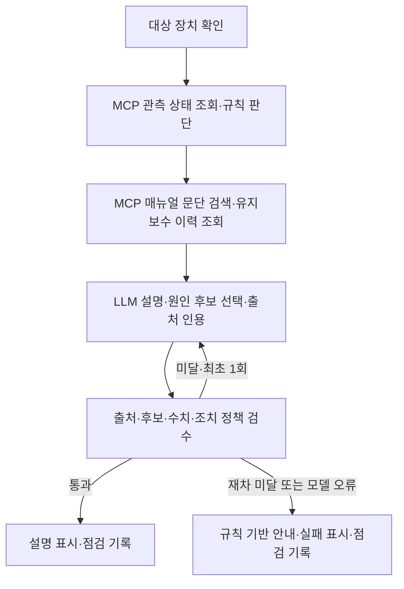

# RAG와 점검 품질 검증

## 이전과 현재

이전 IoT 경로는 수신 지연이면 정해진 파일 하나를 읽었다. 현재는 `data/iot_manuals/`의 10개 Markdown 매뉴얼을 30개 문단으로 나누고 질문·관측 증상으로 BM25 검색한 문단을 실제 생성 입력에 전달한다. 기존 웹 서버용 runbooks 6종은 IoT 검색 대상에서 제외한다.

검색은 표준 라이브러리로 구현한 BM25와 한국어 단어·문자 2-gram, 소규모 동의 표현 확장이다. 벡터·임베딩·Qdrant를 사용하지 않는다. 검색 결과를 생성에 사용하므로 검색 기반 RAG이며, 임베딩 기반 의미 검색으로 소개하지 않는다.

## 처리 흐름



- 검색 결과: `source_id`, 문서 제목, 문단, 본문, BM25 점수, 문서 버전, 출처 구분.
- 점수는 검색 순위용이며 원인 확률이나 신뢰도 백분율이 아니다.
- 후보·출처 ID와 허용 점검 문구를 요청별 JSON Schema의 enum에도 반영한다. 모델은 허용된 조치 문구와 확인 한계를 사용하며 코드로 재검증한다.
- 후보는 검색된 매뉴얼의 후보 목록에서 선택한다. 각 후보에 가능성·출처·추가 점검 항목을 표시한다. 로그 없는 고장 확정 진단을 제공하지 않는다.
- 매뉴얼은 프로젝트에서 작성한 **가상 장치 점검 절차**다. 실제 제조사 문서 또는 현장 검증된 정답으로 표시하지 않는다.
- 관측 상태로 적용 가능한 문서 범위를 제한하고, 그 안에서 질문과 증상에 맞는 문단을 검색한다. 문단 ID의 임의 창작을 코드로 거부한다.
- 형식 검사와 일부 단정 표현 검수는 의미 정확성 전체를 보장하지 않는다. 실제 문장에 대한 별도 검토가 필요하다.
- 원인 후보 메타데이터는 검색 문서의 일부다. 시뮬레이터의 숨겨진 명령 결과나 평가 정답은 모델에 전달하지 않는다.

## 매뉴얼 목록

수신 지연, 배터리 부족, 오프라인, 정상 절전, 전송 경로·게이트웨이, 수집 작업,
복구 검증, 반복 실패, 정상 동작, 데이터 누락·형식 점검.

문서 변경은 MCP/백엔드 재시작 시 새 인덱스에 반영한다. 인덱스 버전은 문서 내용의 해시로 기록된다.

## 재현 가능한 평가

```bash
# 실제 모델 호출 없이 상태 분류·검색·명령 미실행을 확인
.venv/bin/python scripts/evaluate_iot.py --backend rules --output doc/evaluation_rules.json
# 로컬 모델의 실제 응답과 검수 실패·시간을 함께 기록
.venv/bin/python scripts/evaluate_iot.py --backend ollama --model qwen3.5:2b --output doc/evaluation_ollama.json
```

평가기는 임시 DB와 독립 MCP 프로세스를 사용한다. 사용 중인 시연 상태·대화 DB를 초기화하지 않는다.
정답·필수 문서 목록은 `data/evaluation_cases.json`에만 있으며 생성 입력에는 질문만 전달한다.

비교 항목: 이전 규칙 대비 상태 분류 정답 수, 필수 문서의 검색 포함 수, 생성 검수 통과 수,
불필요한 명령 실행 여부, 실제 응답 시간·토큰 수. 기준선 LLM 답변 품질 비교를 수행한 것으로 주장하지 않는다.
생성 검수 통과와 답변 의미의 정확성은 구분한다. JSON의 `manual_review`가 null이면 미검토다.

## 참고

- [LangChain 공식 Retrieval/RAG 설명](https://docs.langchain.com/oss/python/deepagents/retrieval)
- [Stanford IR 교재 BM25 설명](https://nlp.stanford.edu/IR-book/html/htmledition/okapi-bm25-a-non-binary-model-1.html)


## 매뉴얼 추가·수정 방법

`data/iot_manuals/`에 Markdown 파일을 추가한다. 파일의 JSON 메타데이터와 문단 제목을 사용하며 Python 패키지나 외부 벡터 DB 설치는 필요 없다.

```markdown
# 문서 제목
<!-- meta: {"id":"example","title":"문서 제목","issues":["telemetry_delayed"],"tags":["지연","수집"],"version":"1.0","origin":"프로젝트 작성 가상 점검 절차","causes":[{"id":"example_candidate","title":"추가 확인할 원인 가능성","check":"실제 로그를 추가 확인한다."}]} -->

## 판별 근거
어떤 관측 상태에 적용하는지 설명한다.

## 원인 후보와 확인 한계
가능한 원인과 확인하지 않은 정보를 구분한다.

## 조치와 결과 확인
허용 조치와 새 데이터 확인 조건을 설명한다.
```

`id`와 후보 `id`는 기존 문서와 겹치지 않게 한다. 후보 메타데이터는 문서 공통 내용으로 검색 문단과 함께 제공·표시한다.
현재 `issues` 값은 `telemetry_delayed`, `low_battery`, `offline`, `sleeping`, `healthy`, `invalid_data` 등을 사용한다. 새 관측 유형을 추가하려면 문서뿐 아니라 상태 분류 규칙과 평가 사례도 함께 변경한다.

원인 후보나 설명에 실제 관측하지 않은 로그 결과를 쓰지 않는다. 실제 제조사 문서를 추가하면 출처·모델·버전을 명확히 기록하고 가상 절차와 구분한다.
문서 수정 후 백엔드를 재시작하고 검색 평가를 다시 실행한다.
